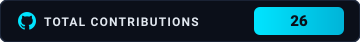

<div align="center">

  <!-- Futuristic Cyber Wave Header Banner -->
  

  <br>

  <!-- Dynamic Typing Subtitle (Crisp Cyan Glow) -->
  <a href="https://github.com/jhanavishukla">
    
  </a>

  <br><br>

  <!-- Verified Identity Badges -->
  <a href="https://github.com/jhanavishukla">
    
  </a>
  &nbsp;
  <a href="https://www.rbunagpur.in/">
    
  </a>
  &nbsp;
  <a href="https://github.com/jhanavishukla">
    
  </a>
  &nbsp;
  

</div>

---

## About Me

```yaml
developer:
  name: Jhanavi Shukla
  education: Second-Year B.Tech in Computer Science and Engineering
  university: Ramdeobaba University, Nagpur
  affiliations:
    - AWS Student Builder Group Member
  hackathons:
    - Smart India Hackathon (SIH) Internal Round Qualifier
  interests:
    - Backend Engineering & Scalable Logic
    - Artificial Intelligence & Machine Learning
    - Data Structures & Algorithms
```

- 🎓 **Undergraduate**: Second-year B.Tech CSE student at **Ramdeobaba University, Nagpur**.
- ☁️ **Community Involvement**: Member of the **AWS Student Builder Group**.
- 💡 **Competitive Spirit**: **Qualified for the internal institutional round of Smart India Hackathon (SIH)**.
- 🎯 **Engineering Interests**: Focused on mastering **Backend Engineering** principles, database interactions, and exploring **AI/ML**.
- 🧩 **Foundations**: Passionate about continuous learning through **Data Structures & Algorithms (DSA)** and writing structured, modular code.

---

## Technical Skills

### Programming Languages

<div align="center">
  
  
  
  
</div>

<br>

### Web & Frontend Development

<div align="center">
  
  
  
</div>

<br>

### Core Computer Science & Problem Solving

<div align="center">
  
</div>

<br>

### Version Control & Collaboration

<div align="center">
  
  
</div>

---

## Featured Projects

| Project | Description | Tech Stack | Repository |
| :--- | :--- | :--- | :---: |
| **JHANAVI.EXE** | Interactive personal developer universe and interactive portfolio system highlighting creative engineering and web design. | `React` `Vite` `JavaScript` `CSS` | [View Repository](https://github.com/jhanavishukla/jhanavi-developer-universe) |
| **QR Code Generator** | Functional utility application designed to generate scannable QR codes dynamically from text, URLs, and data payloads. | `HTML` `CSS` `JavaScript` | [View Repository](https://github.com/jhanavishukla/qr-code-generator) |
| **Nexcent Landing Page** | Modern, responsive landing page interface built following structured UI design principles and responsive layouts. | `HTML` `CSS` | [View Repository](https://github.com/jhanavishukla/nexcent-landing-page) |

---

## Achievements & Community Involvement

- 🏛️ **AWS Student Builder Group**: Member of the AWS Student Builder Group at Ramdeobaba University.
- ⚡ **Smart India Hackathon (SIH)**: Qualified in the Internal Institutional Round of Smart India Hackathon.
- 🎓 **Academic Progression**: Second-year B.Tech Computer Science and Engineering student at Ramdeobaba University, Nagpur, with a focus on DSA, Backend Engineering, and AI/ML.

---

## Coding Profiles & Connect

<div align="center">

<table width="85%">
  <thead>
    <tr>
      <th width="30%" align="center">Platform</th>
      <th width="45%" align="center">Profile / Link</th>
      <th width="25%" align="center">Status</th>
    </tr>
  </thead>
  <tbody>
    <tr>
      <td align="center">
        <a href="https://github.com/jhanavishukla">
          <strong>GitHub</strong>
        </a>
      </td>
      <td align="center">
        <a href="https://github.com/jhanavishukla">
          <code>@jhanavishukla</code>
        </a>
      </td>
      <td align="center">
        
      </td>
    </tr>
  </tbody>
</table>

<br>

<a href="https://github.com/jhanavishukla">
  
</a>
&nbsp;&nbsp;&nbsp;
<a href="#featured-projects">
  
</a>
&nbsp;&nbsp;&nbsp;
<a href="https://github.com/jhanavishukla?tab=repositories">
  
</a>

</div>

---

## Contribution Graph

<div align="center">
  <a href="https://github.com/jhanavishukla">
    
  </a>

  <br><br>

  <picture>
    <source media="(prefers-color-scheme: dark)" srcset="https://raw.githubusercontent.com/jhanavishukla/jhanavishukla/output/github-contribution-grid-snake-dark.svg">
    <source media="(prefers-color-scheme: light)" srcset="https://raw.githubusercontent.com/jhanavishukla/jhanavishukla/output/github-contribution-grid-snake.svg">
    
  </picture>
</div>

---

<div align="center">

  <p><i>"Trying to build resilient backend systems while exploring AI/ML through code."</i></p>

  

</div>
